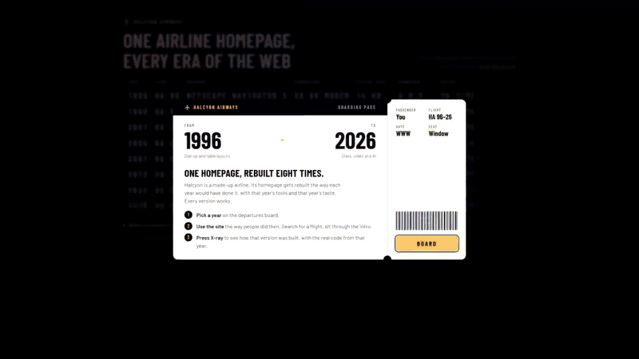

# Halcyon Airways, 1996 to 2026

**[y2k.eladser.dev](https://y2k.eladser.dev)**

[](docs/tour.mp4)

<sub>Click for the full-quality video.</sub>

A made-up airline's homepage, built again for eight different years of the web. Each version is made the way it would have been at the time and runs inside that year's Windows and browser. They all work: you can search for flights, sit through the Flash intro, or dial in.

Pick a year on the departures board. The X-ray panel explains how that version was built, shows code from the period, and highlights the part of the page each technique drives.

## The eras

| Year | Browser | What's in it |
| --- | --- | --- |
| 1996 | Netscape 3, Windows 95 | HTML 3.2 tables, an image-map menu, a status-bar ticker, a mailto form, a visitor counter |
| 1999 | IE 5, Windows 98 | Dial-Up Networking with a synthesized 56K handshake, frames, rollover buttons, DHTML menus, a Y2K pop-up |
| 2001 | IE 6, Windows XP | A Flash 5 site: skip intro, preloader, a techno loop, a `loadVariables` flight search |
| 2004 | Firefox 1.0, Windows XP | CSS layout without tables: faux columns, sliding doors, image replacement, the box model hack, a style switcher |
| 2007 | Firefox 2, Vista | jQuery 1.2.1, AJAX autocomplete and search, a lightbox, a beta badge |
| 2012 | Chrome 23, Windows 7 | Bootstrap 2.2.1, a carousel, typeahead, HTML5 inputs. Drag the window narrower and it goes responsive |
| 2020 | Chrome 87, Windows 10 | A React 17 single-page app with a COVID banner, cookie consent, dark mode, skeleton loading and a chat bubble |
| 2026 | Current Chrome | An AI-generated film and photos, liquid glass, scroll-driven type, and a question box that runs Gemini Nano on your machine when Chrome has it |

## What's real

The libraries are the actual files from the time: jQuery 1.2.1 and 1.8.3, Bootstrap 2.2.1, React 17. Markup and CSS follow each year's habits, hacks included.

Flash, Dial-Up Networking and the old browsers don't run anymore, so those are recreated. The 2001 site is HTML, SVG and the Web Animations API on Flash's 760×440 stage. The modem, the board's clatter and the Flash soundtrack are synthesized with Web Audio. Desktops and browser windows are CSS and SVG. The 1996 counter is real and counts visits through the [Abacus](https://abacus.jasoncameron.dev) API.

The photos and the 2026 film are AI-generated. [CREDITS.md](CREDITS.md) lists the models and everything else that isn't mine.

The board's numbers (typical page size, connection speed, download time) come from period sources, listed on the board under "Where the numbers come from".

## Keys

| Key | |
| --- | --- |
| ← → | previous or next year |
| X | X-ray panel |
| Esc | back to the board, or close the X-ray |

## Run it

```
npm run dev     # http://localhost:8199
npm test        # modem synth tests
```

No build step. `site/` is the whole site, and GitHub Actions publishes it to Pages on every push to `main`.

## Layout

```
site/
  index.html, shell.js, shell.css   board, desktops, browser windows, X-ray
  eras.js                           per-year data: board numbers, X-ray text and code
  modem.js                          V.90 handshake synth
  eras/<year>/                      one standalone site per era
  eras/dialup.js                    replays a page's images at modem speed
scripts/
  art/<year>.html                   source drawings for the period GIFs and JPEGs
  cut.mjs                           turns the drawings into image files
  generate.mjs, stock.mjs           AI media through kie.ai
test/
```

[docs/how-it-works.md](docs/how-it-works.md) covers the shell, the messages between it and the era pages, the image pipeline, and adding a year.

## License

The code is MIT. Bundled libraries and fonts keep their own licenses, listed in [CREDITS.md](CREDITS.md).
